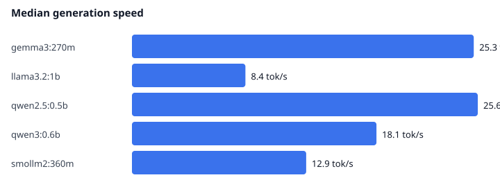
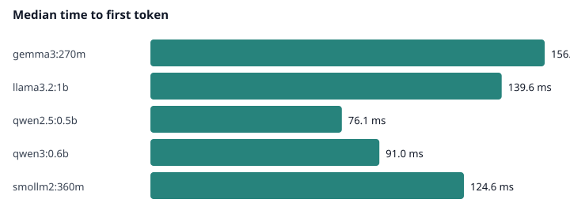

# Benchmark results

Generated by `bench report` from the raw dataset. Every figure below is a median of warm runs, unless stated otherwise.

## Environment

| Property | Value |
|---|---|
| CPU | AMD EPYC Processor (with IBPB) |
| vCPU | 4 |
| RAM | 7.8 GiB total, 2.5 GiB free at start |
| OS / kernel | Linux-6.12.113+deb13-cloud-amd64-x86_64-with-glibc2.41 / 6.12.113+deb13-cloud-amd64 |
| Ollama | 0.40.16 |
| Load average at start | 7.21630859375 / 5.7978515625 / 5.5126953125 |
| Runs | 150 |
| Fixed options | `temperature=0`, `seed=42`, `num_predict=256`, `top_k=1` |

## Per-model summary

| Model | Params | Quant | TTFT (ms) | tok/s | Median latency (s) | p95 (s) | Cold load (s) | Model in memory (MiB) | Runner RSS (MiB) | Failures |
|---:|---:|---:|---:|---:|---:|---:|---:|---:|---:|---:|
| `gemma3:270m` | 268.10M | Q8_0 | 157 | 25.30 | 4.0 | 12.0 | 2.90 | 311 | 1,904 | 0 |
| `llama3.2:1b` | 1.2B | Q8_0 | 140 | 8.40 | 8.6 | 39.6 | 10.70 | 1,453 | 3,168 | 0 |
| `qwen2.5:0.5b` | 494.03M | Q4_K_M | 76 | 25.60 | 2.2 | 12.6 | 4.30 | 464 | 1,856 | 0 |
| `qwen3:0.6b` | 751.63M | Q4_K_M | 91 | 18.10 | 2.6 | 13.9 | 6.90 | 973 | 2,605 | 0 |
| `smollm2:360m` | 361.82M | F16 | 125 | 12.90 | 4.4 | 20.7 | 6.50 | 879 | 2,827 | 0 |

## Generation speed

## Responsiveness

## What these numbers do not tell you

- **Quality.** Speed is not usefulness. These tables say nothing about whether a model answered correctly; read the prompt outputs in the dataset for that.
- **Concurrency.** One request at a time. Throughput under parallel load is lower and is not measured here.
- **Portability.** Figures are tied to the environment above. A 4-vCPU shared VPS is not a desktop CPU; expect large differences.
- **Noise.** A shared machine is never quiet. p95 latency is reported next to the median precisely because run-to-run spread is real.
- **Runner RSS is an upper bound.** It counts resident pages, including the file-backed weights the kernel can reclaim under memory pressure. It is not a private-memory figure, and it is not the memory you need to *buy*: compare it with the model size column.
- **The host was oversubscribed at start**: load average 7.2 on 4 vCPU. These medians describe a busy machine, which is the honest case for a shared VPS but not the best case for this hardware.
